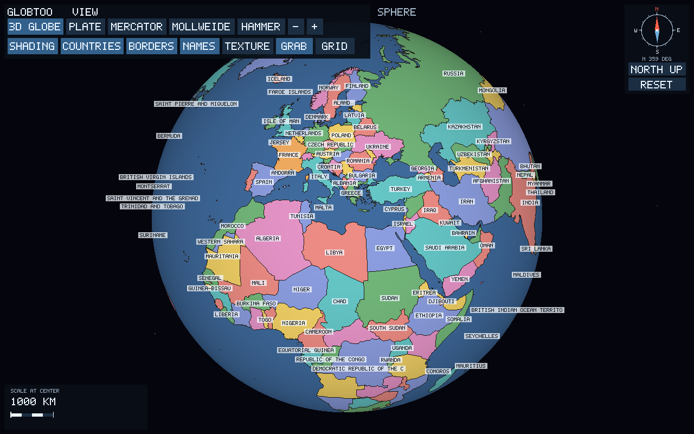

<!--
SPDX-FileCopyrightText: 2026 Ingo Ruhnke <grumbel@gmail.com>
SPDX-License-Identifier: GPL-3.0-or-later
-->

# globtoo

Tactile free-spinning Earth globe (globtoo).

- SDL3 + OpenGL ES 2.0
- Data-oriented / ECS-ish (plain structs + free functions, no class hierarchies)
- Inertia-based spin that feels like turning a real globe
- Smooth zoom down to individual small countries
- Earth texture is **fetched at build time** by the Nix flake (does not bloat the repo)
- Zoom-aware capitals, cities, and major rivers from Natural Earth 10m
- All eight planets, Pluto and 19 major moons: pinned raster sources are tiled and installed by the default Nix package; optional custom planetary maps and Blue Marble relief are supported
- Optional measured elevation/depth and population density (people/km²) layers
- Saturn's rings, with the C, B and A rings, Cassini Division, Encke gap and F ring



## Build (Nix)

```bash
nix build
./result/bin/globtoo
```

The default Nix package fetches and tiles every other body in the catalog
**at build time**, in addition to the existing Earth imagery and geographic
data: the Moon, Mercury, Venus, Mars and the four giant planets from Solar
System Scope (CC BY 4.0), and Io, Europa, Ganymede, Callisto, the Saturnian
and Uranian moons, Triton, Pluto and Charon from NASA/JPL/USGS/APL mosaics
(public domain, via Wikimedia Commons). `globtoo --list-bodies` prints the
catalog; [CREDITS](data/CREDITS.md) lists every source. It installs a
small base texture for each body plus a matching set of GLES2 tiles. No
network access is needed when starting Globtoo. These presentation mosaics
are not suitable for scientific measurements; source registration and precise
IAU landmark alignment remain to be checked on real hardware.

Available packages:

```sh
nix build .#default        # Earth + all other bodies, packaged offline
nix build .#globtoo-earth  # Full Earth maps, without planetary rasters
nix build .#globtoo-max    # 86400x43200 Earth and 100 m/pixel Moon (very large)
nix build .#globtoo-lite   # Lean package; explicitly download Earth on demand
nix build .#planetary-maps # Only the tiled planetary imagery (cached separately)
nix run .#default -- --body mars
```

All variants install the executable, desktop entry, icons, manual, AppStream
metadata, and resources without requiring a launcher that changes the current
directory. To inspect a packaged build, use `find result -type f` or
`man -l result/share/man/man1/globtoo.1`.

## Cross-builds (Nix)

Build these packages from an x86-64 Linux host. Each includes the Earth
preview and Natural Earth 50m country boundaries for offline use.

| Command | Output and how to run it |
| --- | --- |
| `nix build .#globtoo-android` | `result/globtoo.apk`, signed with a public development key. Build and install in one step with `nix run .#install-globtoo-android`. Minimum Android 5.0 (API 21), with ARM and x86 variants in one APK. |
| `nix build .#globtoo-wasm` | WebGL site in `result/`. Run `python3 -m http.server --directory result` and open `http://localhost:8000/`. |
| `nix build .#globtoo-win32` | 32-bit Windows folder. Run `bin/globtoo.exe` with `bin/` and `share/` in the same parent folder. |
| `nix build .#globtoo-win64` | 64-bit Windows folder with the same layout. |
| `nix build .#globtoo-r36s` | ARM64 bundle for ArkOS on the R36S. Copy the whole directory and run `Globtoo.sh` on the handheld. Use the D-pad to move the pointer, A to click or drag, L/R to zoom, and Start to exit. |
| `nix build .#globtoo-r36s-portmaster` | PortMaster folder. Copy `Globtoo.sh` and `globtoo/` into `ports/` on the game card. |
| `nix build .#globtoo-r36s-portmaster-zip` | `result/globtoo.zip` for `ports/PortMaster/autoinstall/`. |

The Windows builds require a driver that supports an OpenGL ES profile via
WGL, or compatible EGL and GLES2 libraries such as ANGLE. The portable
builds keep the full body catalog and use solid colors for bodies without
bundled textures. The native packages above provide the larger imagery sets
and 10m geographic overlays.

## Install with CMake (Linux)

Dependencies: C++20 compiler, CMake 3.16+, SDL3 (including its CMake
package), OpenGL ES 2.0 and GEOS. The optional downloader uses pkg-config,
libcurl and OpenSSL. For a complete political map, provide the Natural Earth
50m/10m GeoJSON inputs under `assets/` before configuring (Nix downloads them
automatically). The optional populated-place and river overlays require
`assets/places_10m.geojson` and `assets/rivers_10m.geojson` at configure
time; Nix also downloads these sources automatically and compiles a compact
`geographic_10m.gfeat` asset. For a textured standalone build, supply a real image with
`-DGLOBTOO_EARTH_TEXTURE=/absolute/path/to/earth.jpg`. Without that option,
Globtoo uses the solid-color globe (or accepts `--texture FILE` at runtime).
No placeholder Earth image is distributed or installed.

```sh
cmake -S . -B build -DCMAKE_BUILD_TYPE=Release \
  -DGLOBTOO_EARTH_TEXTURE=/path/to/real-earth-texture.jpg
cmake --build build -j
cmake --install build --prefix "$HOME/.local"
"$HOME/.local/bin/globtoo" --version
```

For a system-wide installation use a suitable `--prefix` (for example,
`/usr/local`). CMake installs `bin/globtoo`,
`share/globtoo/{assets,shaders}`, `share/applications/`, hicolor icons,
`share/metainfo/`, `share/man/man1/globtoo.1`, and licensing information.
You can run the binary from any directory; the executable finds its resources
relative to its install location. Set `GLOBE_ASSET_DIR` to override that
location, including for portable/custom texture and map installations.

The on-screen application icon is installed both for desktop launchers and as
the SDL window icon. Run `man globtoo` after installing to a prefix on your
manpage search path.

For persistent maps of any non-Earth body, run
`python3 tools/install_planetary_map.py /path/to/prepared-tiles` after
[preparing and auditing the source](docs/PLANETARY_MAPS.md). The viewer then
finds the tiles under `$XDG_DATA_HOME/globtoo/imagery/<body>` automatically,
including in Nix installs; per-user maps override the bundled texture and
tiles together. Packagers can instead supply
`-DGLOBTOO_MARS_PREPARED_MAP=/path/to/mars-tiles` at CMake configure time,
or compose a Nix build with `globtoo.lib.${system}.withPlanetaryMaps`.
The Nix installation runs an offline post-install audit on every included
planet: it checks image decoding, manifest/grid consistency, attribution,
complete tile coverage, and byte-identical preview/base textures. Prepared
maps retain their SHA-256 audit. This catches missing/corrupt packaging
outputs but does **not** validate scientific coordinate registration.
The full/default flake package already fetches the three pinned sources;
`withPlanetaryMaps` replaces only the bodies explicitly specified in the
argument set. `withPlanetaryMapsLite` adds only the specified prebuilt maps to
the lite package. Neither function automatically fetches additional sources.

See [Raster layers and tiling](docs/RASTER_LAYERS.md) for high-resolution
imagery and relief preparation and selection, and
[planetary maps](docs/PLANETARY_MAPS.md) for converting and packaging
large Moon, Mars and Io mosaics with correct longitude direction, [measured elevation and bathymetry](docs/ELEVATION.md),
and [population-density maps](docs/POPULATION.md). The POP button and
`--layer population --population-dir DIR` select locally compiled density
raster tiles. Original density data and its reference year are supplied
explicitly at build time rather than guessed.
See [Release and packaging](docs/RELEASE.md) for version tagging and checks.
For the data conversion, ranking and geographic-overlay format, see
[Geographic overlays](docs/GEOGRAPHY.md). For upcoming map, planet, and
downloadable-layer features, see the ordered
[development roadmap](TODO.md).

Or development shell:

```bash
nix develop
mkdir build && cd build
nix build ..#earth-imagery -o /tmp/globtoo-imagery   # optional close-zoom tiles
cmake .. -DGLOBTOO_IMAGERY_TILES=/tmp/globtoo-imagery
make -j
# Optional: provide assets/countries_50m.geojson and/or
# assets/countries_10m.geojson, then re-run cmake to precompile their meshes.
# Legacy assets/countries.geojson is still supported as runtime fallback.
./globtoo
```

## Command-line markers and version

Markers are rendered on the globe and **all** flat map projections, including
animated transitions. Pins remain a constant pixel size when zooming; labels
are optional. Pins on the far side of the globe are hidden. Multiple `--marker`
arguments, including different formats, may be combined:

```sh
globtoo --marker '52.5200,13.4050|Berlin' \
        --marker '40°41′21″N, 74°02′40″W' --label 'Liberty Island' \
        --marker 'geo:48.8583,2.2945' --label 'Eiffel Tower' \
        --center '52.5200,13.4050'

# Colors and sizes apply to subsequent pins; --marker-lonlat uses GIS order.
globtoo --marker-color '#ff6565' --marker-size 9 \
        --marker-lonlat '13.4050,52.5200' --label 'Berlin' \
        --marker-color '#66ddff' --marker '+40.6892-074.0445/'

# CSV (latitude,longitude,label) or coordinate | label on each line:
globtoo --marker-file locations.csv

globtoo --version
globtoo --help
```

Use `--marker` / `-m` repeatedly, `--label` / `-l` for the previous pin,
`--marker-color #RRGGBB` and `--marker-size 2..32` for subsequent pins,
`--marker-file` for bulk input, `--center` for the starting viewpoint, and
`--texture` (or the legacy positional filename) for a custom Earth image.
`--layer imagery|relief|elevation|population` selects the starting raster;
`--imagery-dir DIR` supplies higher-resolution true-color close-up tiles
for the normal Imagery mode, `--body-imagery-dir moon=DIR` (any non-Earth body)
provides independent high-resolution planetary tiles, `--relief-dir DIR` supplies a separate visual relief
layer, and `--elevation-dir DIR` uses a measured elevation/bathymetry tile set
with a physical-unit legend.
By default the starting viewpoint still follows the local timezone.

The coordinate parser understands signed decimal degrees (latitude first),
`N/S/E/W` directional prefixes or suffixes, degrees/minutes/seconds (`° ' "`
or `:` separators), degrees/decimal minutes, `geo:latitude,longitude` URIs
(RFC 5870; altitude accepted but not used), and ISO 6709 signed pairs such as
`+5230.5+01324.5/`. It also accepts whitespace-separated coordinates and
`--marker-lonlat` for longitude-first GIS values. Numeric values are validated
against WGS84 latitude/longitude ranges. For examples and limitations see
[Marker CLI](docs/MARKERS.md).

The top-level `VERSION` file is the sole version source. `--version` (and the
window title) display the same full version produced by CMake or Nix. Git
`-dev` builds include the revision count and hash; releases do not.

## Full and lite Nix packages

`nix run .` starts the full offline Earth package with its bundled NASA Blue
Marble imagery and 10m geographic features. `nix run .#globtoo-lite` uses the same
viewer, keeps 50m country boundaries, but omits the bundled imagery and the
larger 10m geographic datasets. The lite package adds an **opt-in**, verified
Earth image downloader (no automatic network traffic):

```sh
nix run .#globtoo-lite -- --download-asset earth
nix run .#globtoo-lite
```

The texture is stored in the XDG cache for later offline launches. The
normal full package does not link to libcurl or OpenSSL for downloading.
See [download and package details](docs/DOWNLOADS.md) for the source hash,
cache behavior, and limitations; currently only Earth is in the download
catalog, not the other bodies.

## Raster textures

The default Nix build tiles pinned 21,600×10,800 NASA Blue Marble imagery
(oceans recoloured lighter) and installs a 4096-pixel base image from the
same source for distant views. Other **high-resolution Imagery tiles** can
be supplied with `--imagery-dir DIR` or `-DGLOBTOO_IMAGERY_TEXTURE=...`. There is also an
**optional high-resolution Relief** layer: a real NASA Blue Marble topography
and ocean-bathymetry image preprocessed into GLES2-friendly tiles, with
on-demand local tile loading at close zoom. The optional layer has its own
**RELIEF** button and `--layer relief` startup switch; TEXTURE still controls
visibility, independently of political colors. On builds without relief tiles,
the button reports that the optional data is absent.

An optional **ELEV** layer displays numerical land elevation and ocean depth,
with a signed **metres** legend and source/year attribution. It converts NOAA
ETOPO1-style signed 16-bit raster values into the same GLES2 tile format,
without treating brightness as measured height. See
[elevation preparation instructions](docs/ELEVATION.md) for the source format,
`--elevation-dir`, and `-DGLOBTOO_ELEVATION_RAW=...` build option.

The default package intentionally does not silently fetch or ship a new large
raster. See [raster preparation instructions](docs/RASTER_LAYERS.md) for a
NASA source URLs, Pillow tile preprocessing, and both imagery and relief setup.
Measured population density is also supported as an optional layer; shipping a
new high-resolution source in the default Nix package still requires a verified
source checksum and an actual Nix build.

## Controls

All on-screen controls sit along the **bottom** edge: the toolbar on the
left, the compass on the right and the scale bar between them (in narrow
windows the compass and scale stack above the toolbar). Press **Tab** to hide
or restore the GUI for an unobstructed map view. Country
names, markers, and the optional geographic grid remain visible.

- **< BODY >** (toolbar header): previous / next planet or moon.
- **3D Globe**: classic tactile, inertia-based sphere.
- **Plate**: equirectangular geographic map.
- **Mercator**: cylindrical conformal projection (latitude clipped at 85°).
- **Mollweide**: equal-area ellipse.
- **Hammer**: equal-area oval.
- **− / +**: zoom out / in.
- **Shading**: toggle directional shading (flat maps automatically fade to unlit).
- **Countries**: toggle the political color overlay independently of the texture.
- **Borders**: toggle national boundary outlines.
- **Names**: toggle English country names; labels are omitted when overlapping.
- **Texture**: toggle the Earth imagery independently of the country colors. When both
  are enabled (the default), translucent country colors mix with the texture
  so terrain remains visible beneath the colors. Either layer can be shown alone.
- **Landmarks** (solid-surface bodies only): toggle sourced feature-center labels, or press **F**.
- **Capitals** (Earth only): toggle national-capital diamonds and English labels.
  Capital locations are always eligible regardless of zoom, but labels
  are decluttered rather than drawn over one another.
- **Cities**: toggle dots and labels for other Natural Earth populated places.
  The display adds smaller cities as you zoom closer; rank and population
  determine their priority.
- **Relief / Elev / Pop**: switch between standard imagery and the optional
  high-resolution NASA relief, measured elevation or population-density
  rasters. The buttons are dimmed when the dataset is not installed.
- **Rivers**: toggle major rivers and lake centerlines, in blue. Additional
  tributaries are revealed as you zoom in. Lines have a geographic width
  (about 2 km for the largest rivers) with a minimum on-screen thickness. River segments follow the same
  rotating geography and moving map seam as the country outlines.
- **Grid**: toggle the adaptive geographic latitude/longitude graticule in
  all globe and map projections. Intervals get finer when zoomed in. Lines
  follow the actual geographic meridians/parallels, including polar rotation;
  these are angles and **not** equally spaced kilometer lines, particularly
  near the geographic poles.
- **Scale bar (bottom, left of the compass)**: local great-circle distance measured at the
  view center, automatically displayed in km or m. With the grid enabled it
  also shows the current latitude/longitude grid spacing. The graduated bar updates
  with zoom, projection, and globe/map transitions. Its value applies at the
  **center**; on projections, distortion increases away from the center.
- **Grab / Arcball (compass panel, below Reset)**: switch the 3D globe mouse-control mode.
  The button shows the currently selected mode; `G` is its shortcut.
- **Compass (lower-right)**: live geographic N/E/S/W heading for the globe and every 2D projection.
- **North Up**: click the button or compass rose to straighten the view without panning or changing zoom (also works after a polar crossing).
- **North Lock**: toggle continuous North-up correction while turning the globe or reprojecting the map. When locked, manual roll gestures are disabled; click again to unlock.
- **Reset**: in the compass panel; restore the timezone-relative viewpoint, North-up orientation, and default zoom without changing the selected projection.

Mouse: **left-drag** spins the globe or rotates/reprojects the Earth in 2D;
**middle-drag** grabs and slides a 2D map like a paper sheet, while on the
3D globe it rolls the view. **Shift+middle-drag** or **Shift+left-drag** rolls a
flat map around the viewport center (unless North Lock is enabled). Mouse
wheel zooms with smaller, reciprocal increments. The rotation is retained when unfolding or folding.
The geographic grid and distance ruler track the point beneath screen center
after middle-drag; folding to 3D centers that same point.
Flat maps can be dragged north or south **through the poles**. Rather than
mirroring a flat map sheet, the entire Earth rotates and is reprojected around
the new geographic center. There are no mirrored north/south map copies.
Both horizontal and vertical drags rotate the spherical coordinate frame,
so navigation remains continuous even at a geographic pole.
The 3D globe now permits roughly **1.9× closer** views (minimum camera
distance 1.08 Earth radii versus 1.15 previously). Flat-map zoom reaches
**80×** instead of 60×. The globe sphere uses a finer mesh to stay smooth
at close range. The 10m country mesh is selected automatically at these scales;
optional Imagery tiles and the Relief layer supply additional raster detail
when configured; otherwise Earth imagery retains its original resolution.
Roll gestures rotate the globe or flat map around the screen center when North Lock is off.
Optional shortcuts: `1..5` select projection, `Space` shading, `B` borders,
`N` names, `P` political coloring, `V` texture, `Tab` toggle GUI,
`G` Grab/Arcball, `T` trackball,
`Esc` quit (or release trackball).

The default view is centered on the **representative city of the system's IANA
TZ zone** (from the installed `zone1970.tab`/`zone.tab`). For example,
`TZ=Europe/Berlin globtoo` centers on Berlin's zone reference coordinates.
If the timezone has no geographical entry, the app uses the UTC offset as an
approximate longitude and latitude 0°. A timezone alone is not a precise
geolocation.

The **globe↔map transitions animate the same geometry** between a sphere and
flattened projected coordinates. Projection-to-projection changes are smoothly
interpolated too; this is not a crossfade between static images. See
`docs/MAP_VIEW.md` for design details and current limitations.

## Architecture notes

Plain C++20 structs + free functions. No deep inheritance.
Components live as data; systems are free functions that operate on them.
Ready for later expansion (country borders, VR, etc.).


## Country data

Natural Earth Admin-0 **1:50m and 1:10m** countries (public domain) are
fetched and converted into binary GPU-ready meshes at build time. The viewer
switches to 10m for close zoom, with hysteresis to avoid LOD flicker. Each generated mesh now stores English `NAME_EN` country labels, interior
label anchors, and geographic coordinates alongside the shared border/fill
vertices. No GeoJSON parsing or triangulation is needed at launch in the Nix package.
GEOS (>= 3.10) triangulates polygons, including holes; a depth-tested
spherical overlay hides the far hemisphere. See `docs/COUNTRIES.md`.

To work on the geometry without SDL3/GLES installed:

```bash
cmake -S . -B build-geometry -DGLOBTOO_BUILD_APP=OFF
cmake --build build-geometry -j
ctest --test-dir build-geometry --output-on-failure
```

Run the geometry tests using `ctest --test-dir build --output-on-failure`.


## License

Globtoo is licensed under the **GNU General Public License, version 3 or
(at your option) any later version** (`GPL-3.0-or-later`); see [LICENSE](LICENSE).
The vendored `external/stb_image.h` retains its upstream MIT license.
AppStream metadata is CC0-1.0. Natural Earth geographical data and the fetched
NASA-derived Earth imagery are public domain. See [asset credits](data/CREDITS.md)
and per-file SPDX declarations for details.

Check license metadata using `reuse lint` (available in the Nix development shell
with `nix develop -c reuse lint`).

### Planetary bodies (experimental)

`--body NAME` selects a body at startup; `--list-bodies` prints all of them
(slug, name, kind, parent and mean radius). `M` / `Shift+M` or the
**<** / **>** buttons around the body name in the toolbar header cycle forward and backward through the
catalog, which is ordered by distance from the Sun with each planet followed
by its moons. Gas giants are rendered at their cloud tops and have no
landmarks. Use `--body-texture mars=/path/to/map.jpg`
(repeatable) to assign a north-up, east-positive equirectangular texture;
`--texture FILE` sets the initial body's texture. Without one, non-Earth
bodies appear as neutral-colored spheres. Earth political, city and river
features are hidden on the others. Optional, externally supplied and
source-attributed planetary textures can be normalized and installed by CMake;
use `GLOBTOO_<BODY>_TEXTURE` (for example `GLOBTOO_TITAN_TEXTURE`) together with their required source license, longitude
axis, planetocentric latitude and image-origin settings. See [planetary map guide](docs/PLANETARY_MAPS.md)
for the preprocessing tool, source catalogs, caveats, and packaging example.
Only the pinned, attributed sources in `flake.nix` are fetched by default.
For locally acquired and documented planetary mosaics, use
`python3 tools/prepare_planetary_map.py SOURCE OUTPUT --body ...`
with explicit longitude, latitude, projection, citation, license, and optional
trusted SHA-256 pin. This generates an auditable tile directory plus a
landmark QA sheet in one offline step; see the
[planetary-map preparation guide](docs/PLANETARY_MAPS.md#one-command-local-source-preparation-and-audit).

An offline [planetary alignment QA tool](docs/PLANETARY_MAPS.md#official-raster-candidates-and-landmark-registration)
can annotate locally supplied maps or normalized tile previews with IAU
landmark centers and a coordinate grid; it does not itself prove scientific
map registration. The guide also links candidate official NASA/JPL maps
without embedding them or asserting unchecked hashes.

The non-Earth **LANDMARKS** button (or **F**, including while controls are
hidden) shows a small catalog of IAU-named craters, maria, mountains and
volcanic, chaos and icy features sourced from the USGS Gazetteer of Planetary Nomenclature.
This overlay works even without a surface texture. Earth's country and city
controls are replaced by planetary controls on the other bodies. Find the
available names without starting SDL, then launch centered on one:

```sh
globtoo --list-features
globtoo --focus 'Olympus Mons'
globtoo --focus 'Loki Patera' --body io
```

`--focus` selects the feature's body and initial viewpoint; conflicting
`--body` or `--center` options are rejected. The landmarks are approximate
feature centers (Io's source coordinates use **west-positive** longitude and
planetographic latitude), not a high-precision surface geodesy product. See
[planetary feature sources and conventions](docs/PLANETARY_MAPS.md#named-planetary-features).
